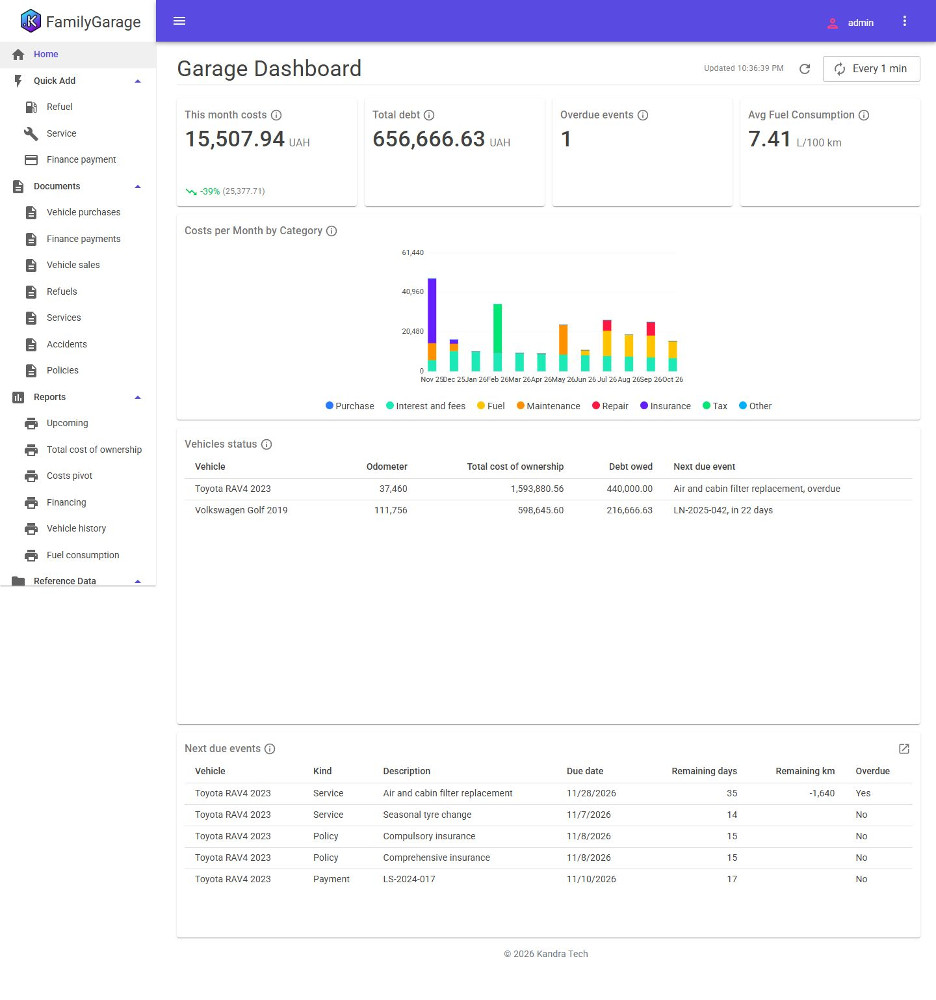

# Family Garage

**English** | [Українська](README.uk.md)

The history and the cost of the family's cars: how each was bought (cash, bank loan or leasing), what was spent on it since, what was replaced and when, and what is due next.

## What it shows

- A hierarchical **Items** catalog for parts and works; a work item carries its service interval in km and months.
- A Service document that is either **detailed** (lines of items) or a **summary** (one amount), switched on the form.
- **Periodic information registers** as the "last state": the odometer and the last time each job was done; due events by km or months, whichever comes first.
- Purchase on a **loan or leasing**: the debt is a balance register, interest and fees are monthly costs, the principal is not.
- Document links (Accident → Service), file attachments, a costs pivot, total cost of ownership, fuel consumption.
- Daily **reminders** as in-app notifications, and a home **dashboard** with drill-down into the Upcoming report.

## Brief

[prompt/PROMPT.md](prompt/PROMPT.md) (v4)

## Runs

| Harness | Model | Brief | Template / Core | Time | Tests |
|---|---|---|---|---|---|
| [Google Antigravity](runs/antigravity/) ([results](runs/antigravity/RESULTS.md)) | Gemini 3.8 Flash (medium) | v4 | 1.3.6 / 0.5.25 | ~2 h 50 min | 23 delivered, 36 after review fixes |

To add a run, see [CONTRIBUTING.md](../CONTRIBUTING.md).

