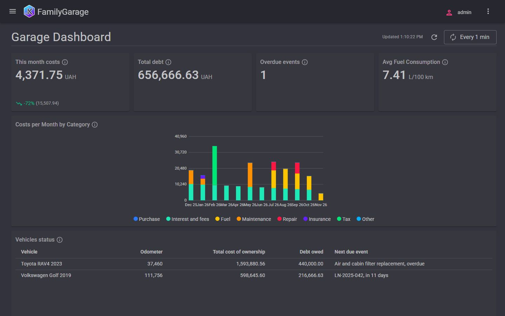

# Family Garage

**English** | [Українська](README.uk.md)

The history and the cost of the family's cars: how each was bought (cash, bank loan or leasing), what was spent on it since, what was replaced and when, and what is due next.

## What it shows

- A hierarchical **Items** catalog for parts and works; a work item carries its service interval in km and months.
- A Service document that is either **detailed** (lines of items) or a **summary** (one amount), switched on the form.
- **Periodic information registers** as the "last state": the odometer and the last time each job was done; due events by km or months, whichever comes first.
- Purchase on a **loan or leasing**: the debt is a balance register, interest and fees are monthly costs, the principal is not.
- Document links (Accident → Service), file attachments, a costs pivot, total cost of ownership, fuel consumption.
- Daily **reminders** as in-app notifications, and a home **dashboard** with drill-down into the Upcoming report.

## Brief

[prompt/PROMPT.md](prompt/PROMPT.md) (v4)

## How it was built

The first version was built from the brief by Google Antigravity (Gemini 3.8 Flash, medium) in about 2 h 50 min, then
reviewed and polished with Claude Code (Claude Opus). The review fixed thirteen bugs, rebuilt the demo data to the brief
and added the missing acceptance tests (23 in the first version, 36 now). What came from the brief, what the review
changed and what is still weak: [BUILD-NOTES.md](BUILD-NOTES.md).

## Run it

The application is in [app/](app/); its [README](app/README.md) says how to build, start with the demo data, sign in and
schedule the reminders.

