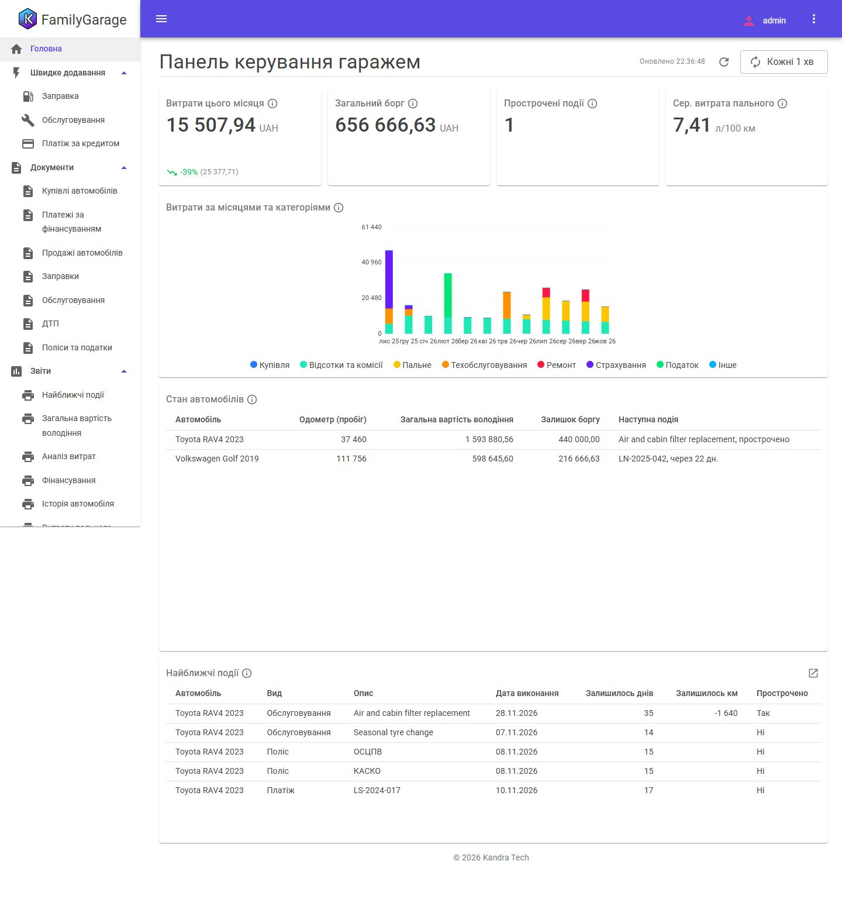

# Сімейний гараж

[English](README.md) | **Українська**

Історія та вартість сімейних автомобілів: як кожне куплено (готівкою, у кредит або лізинг), що на нього витрачено відтоді,
що й коли замінено і що настає далі.

## Що показує

- Ієрархічний довідник **Номенклатура** для запчастин і робіт; робота має свій інтервал обслуговування в кілометрах і
  місяцях.
- Документ «Обслуговування» буває **детальним** (рядки номенклатури) або **підсумковим** (одна сума), перемикається на
  формі.
- **Періодичні регістри відомостей** як «останній стан»: пробіг і останнє виконання кожної роботи; подія настає за
  кілометрами або місяцями — що раніше.
- Купівля в **кредит або лізинг**: борг — регістр залишків, відсотки й комісії — щомісячні витрати, тіло кредиту — ні.
- Зв'язки документів (ДТП → Обслуговування), вкладені файли, зведена таблиця витрат, повна вартість володіння, витрата
  пального.
- Щоденні **нагадування** як сповіщення в застосунку і головний **дашборд** із переходом у звіт «Найближчі події».

## Бриф

[prompt/PROMPT.md](prompt/PROMPT.md) (v4), англійською.

## Запуски

| Середовище | Модель | Бриф | Шаблон / Core | Час | Тести |
|---|---|---|---|---|---|
| [Google Antigravity](runs/antigravity/) ([результати](runs/antigravity/RESULTS.md), англійською) | Gemini 3.8 Flash (medium) | v4 | 1.3.6 / 0.5.25 | ~2 год 50 хв | 23 від агента, 36 після виправлень рецензії |

Як додати свій запуск — див. [CONTRIBUTING.md](../CONTRIBUTING.md) (англійською).

