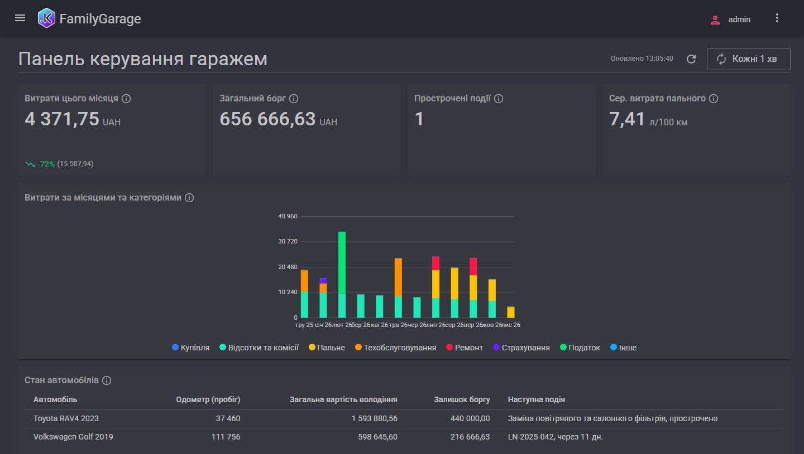

# Сімейний гараж

[English](README.md) | **Українська**

Історія та вартість сімейних автомобілів: як кожне куплено (готівкою, у кредит або лізинг), що на нього витрачено відтоді,
що й коли замінено і що настає далі.

## Що показує

- Ієрархічний довідник **Номенклатура** для запчастин і робіт; робота має свій інтервал обслуговування в кілометрах і
  місяцях.
- Документ «Обслуговування» буває **детальним** (рядки номенклатури) або **підсумковим** (одна сума), перемикається на
  формі.
- **Періодичні регістри відомостей** як «останній стан»: пробіг і останнє виконання кожної роботи; подія настає за
  кілометрами або місяцями — що раніше.
- Купівля в **кредит або лізинг**: борг — регістр залишків, відсотки й комісії — щомісячні витрати, тіло кредиту — ні.
- Зв'язки документів (ДТП → Обслуговування), вкладені файли, зведена таблиця витрат, повна вартість володіння, витрата
  пального.
- Щоденні **нагадування** як сповіщення в застосунку і головний **дашборд** із переходом у звіт «Найближчі події».

## Бриф

[prompt/PROMPT.md](prompt/PROMPT.md) (v4), англійською.

## Як його побудовано

Першу версію за брифом побудував Google Antigravity (Gemini 3.8 Flash, medium) приблизно за 2 год 50 хв, потім її
перевірили й довели до ладу в Claude Code (Claude Opus). Рецензія виправила тринадцять помилок, перебудувала демодані
за брифом і додала відсутні приймальні тести (23 у першій версії, 36 тепер). Що прийшло з брифу, що змінила рецензія і
що ще слабке — у [BUILD-NOTES.md](BUILD-NOTES.md) (англійською).

## Запуск

Застосунок — у [app/](app/); його [README](app/README.md) (англійською) пояснює, як зібрати, запустити з демоданими,
увійти й запланувати нагадування.

