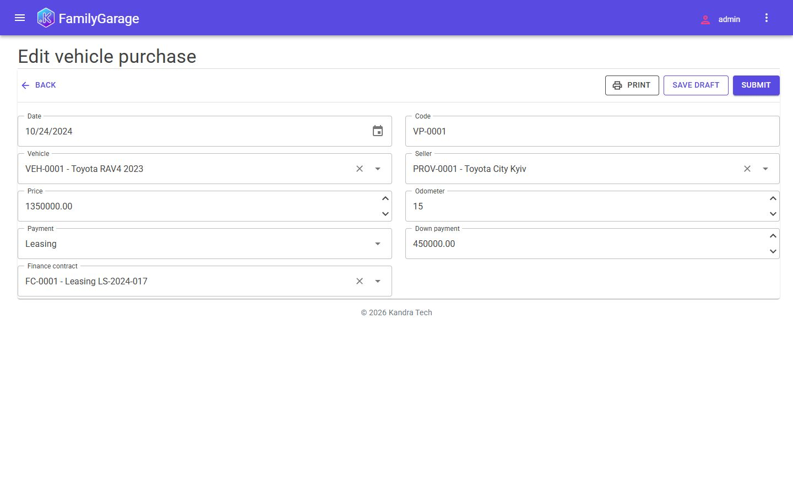
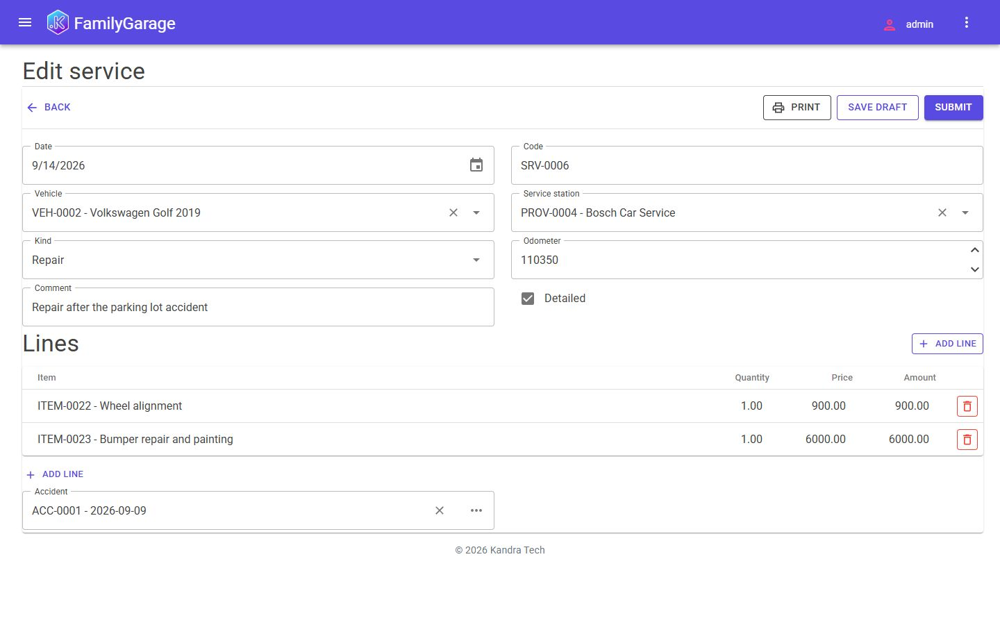
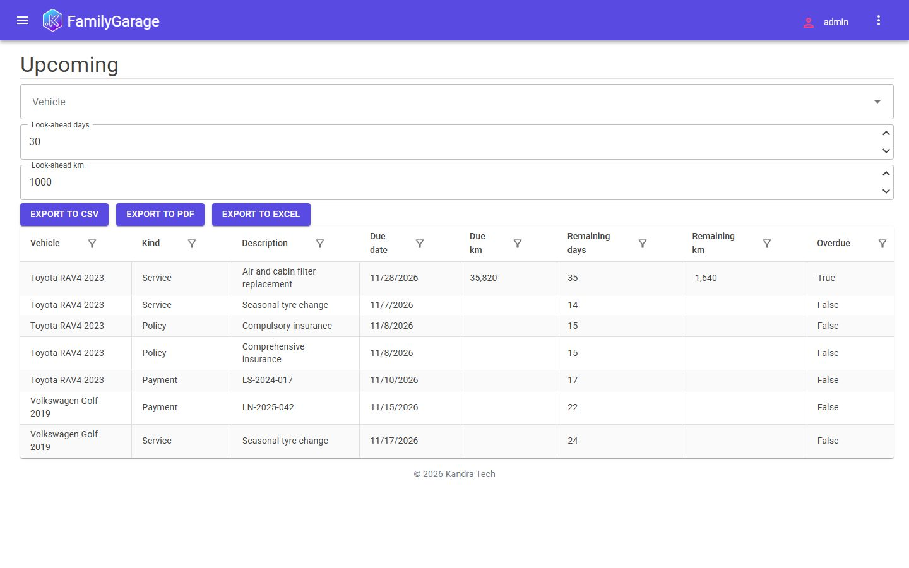
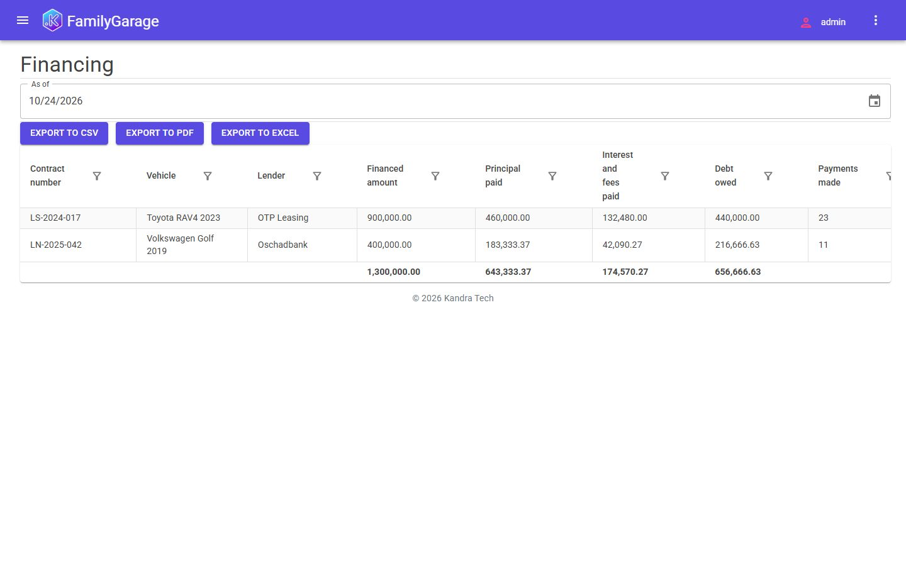

# Family Garage

The history and the cost of a family's cars on the [Kandra](https://kandra.tech) engine, built by Google Antigravity from
[the brief](../../prompt/PROMPT.md). What the run is and how it was reviewed: [RESULTS.md](RESULTS.md).


## Build and test

Needs the .NET 10 SDK. Packages come from nuget.org and the public Kandra feed (`nuget.config`).

```bash
dotnet build FamilyGarage.slnx
dotnet test FamilyGarage.slnx
```

## Run with the demo data

```bash
dotnet run --project src/FamilyGarage.WebApi --launch-profile FamilyGarage.UI -- --ACCEPT_EULA=Y --Kandra:Setup:Mode=Demo
```

Open `https://localhost:7226` (accept the development certificate) and sign in as `admin` / `Admin!1`. The demo
installation loads two cars (one on leasing bought two years ago, one bought used last year on a bank loan) with their
monthly payments, about 25 parts and works, six providers, and about 30 refuels, services, policies and an accident with
its repair, dated relative to today. On any day it is loaded, one job is overdue, a policy ends within the look-ahead and
a payment is due.

Without `--Kandra:Setup:Mode=Demo` the first start opens the setup wizard, which creates the administrator and an empty
database. The SQLite file is in `src/FamilyGarage.WebApi/db/`; delete it to start again.

## Daily reminders

The **Upcoming reminders** data processor sends an in-app notification for every due or overdue event, once per event.
It does not run by itself until an administrator schedules it: **Admin > Scheduler > Jobs**, new job, processor
*Upcoming reminders*, a daily trigger (for example at 07:00), and the user the notifications go to as *Run as*. The
look-ahead (30 days, 1 000 km by default) is set on the job's input; the defaults come from the constants of the same
name.

## Screenshots

| | |
|---|---|
|  |  |
|  |  |

Ukrainian versions of every screenshot are in [screenshots/](screenshots/) (`*.uk.jpg`).
