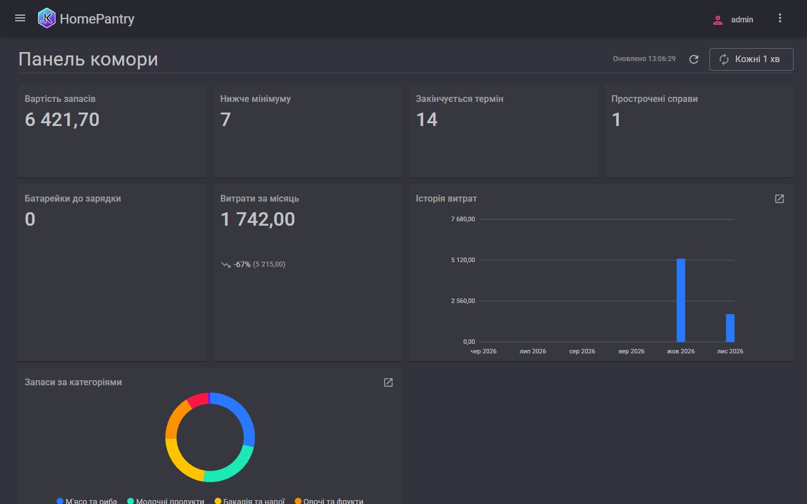

# Домашня комора (за мотивами Grocy)

[English](README.md) | **Українська**

Які продукти й господарські товари є вдома, де вони лежать, коли зіпсуються, що з них можна приготувати і що докупити.
За мотивами [Grocy](https://grocy.info/) («ERP за межами вашого холодильника»), змодельовано в термінах Kandra; див.
[NOTICE.md](../NOTICE.md).

## Що показує

**Частина A: запаси, рецепти, покупки**
- Запаси як **регістр залишків за товаром, місцем і терміном придатності** (партії).
- Списання за принципом **«першим спливає — першим іде»**, захист від від'ємних залишків, переміщення й інвентаризація.
- Рецепти, інгредієнти яких заповнюються в документ «Приготування» й масштабуються до кількості порцій.
- Пошук товару за штрихкодом у полях вибору, список покупок, з якого створюється «Закупівля», головний **дашборд**.

**Частина B: домашнє господарство**
- **Розширює конфігурацію частини A**, а не починає нову.
- Хатні справи й батарейки з періодичністю, техніка з інструкціями та гарантією, тижневий план харчування, що додається до
  потреб у покупках частини A, щоденні нагадування, нові віджети на дашборді частини A.

## Бриф

[prompt/PROMPT-A-stock.md](prompt/PROMPT-A-stock.md) (v1), потім [prompt/PROMPT-B-household.md](prompt/PROMPT-B-household.md)
(v1) у тому самому проєкті; англійською.

## Як його побудовано

Кожну частину за її брифом побудував Google Antigravity (Gemini 3.8 Flash, medium), частину B — у конфігурації,
побудованій у частині A, а потім її перевірив і виправив Gemini Argon 4 (high). Потім увесь застосунок ще раз перевірили з Claude Code, який
виправив, зокрема, роботу з календарними днями в часовому поясі користувача. Що зробив кожен крок — у [BUILD-NOTES.md](BUILD-NOTES.md) (англійською).

## Запуск

Застосунок (частини A і B) — у [app/](app/); його [README](app/README.md) (англійською) пояснює, як зібрати,
запустити з демоданими й увійти.

