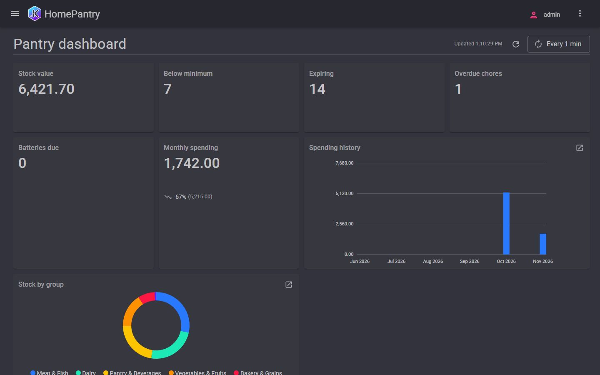
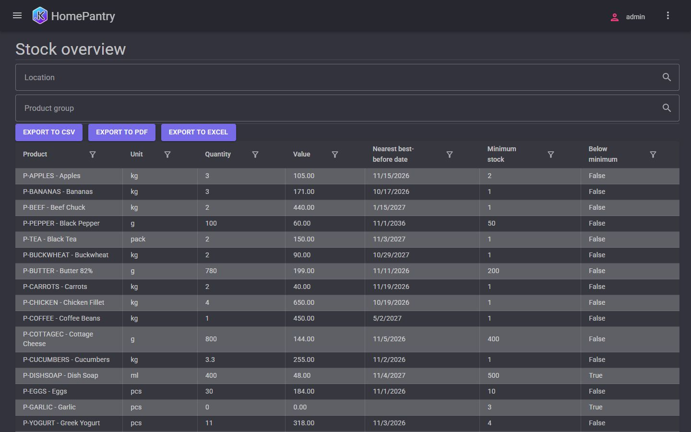
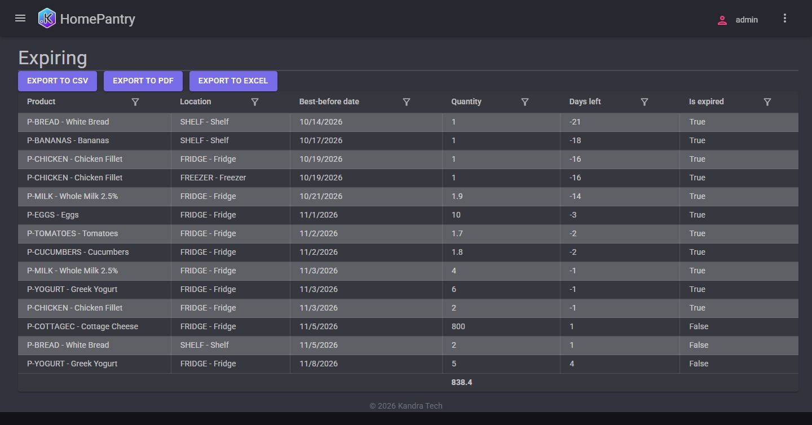
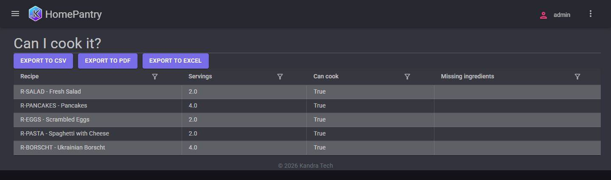
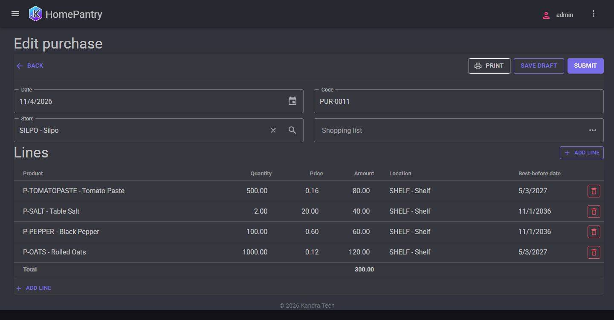
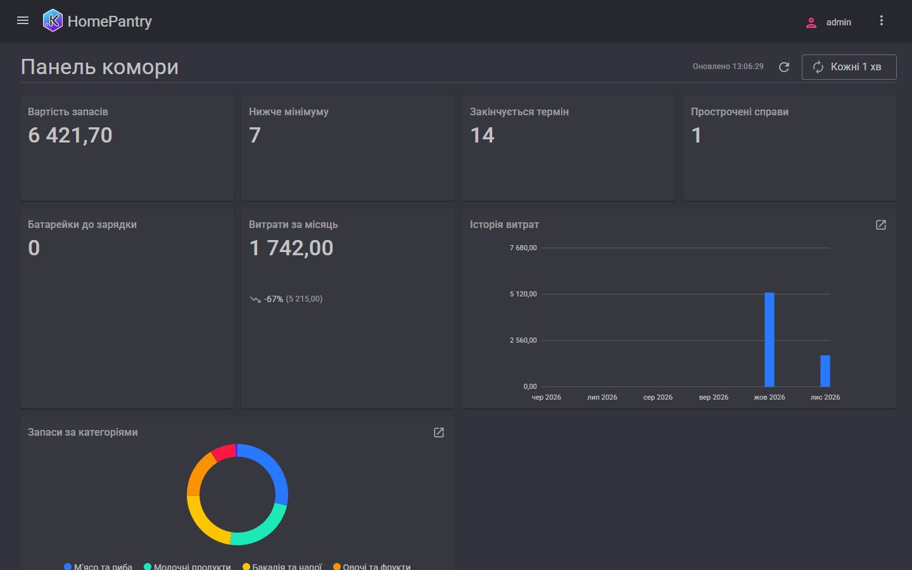

# HomePantry

Single-household pantry, stock, and household routine management application built on the Kandra platform. How it was built and reviewed: [BUILD-NOTES.md](../BUILD-NOTES.md).

## Build

```bash
dotnet restore
dotnet build HomePantry.slnx
```

## Run

To run the application with the Web UI on `http://localhost:5228` (and `https://localhost:7228`):

```bash
dotnet run --project src/HomePantry.WebApi --launch-profile HomePantry.UI
```

To run with automatic demo data seeding and sample user initialization:

```bash
$env:Kandra__Setup__Mode="Demo"
$env:ACCEPT_EULA="Y"
dotnet run --project src/HomePantry.WebApi --launch-profile HomePantry.UI
```

The demo data comes in two languages with the same content and different names: English (`homepantry-demo-en`, the default) and Ukrainian (`homepantry-demo-uk`). To load the Ukrainian one add `$env:Kandra__Setup__DemoPackage="homepantry-demo-uk"` (environment variable `Kandra__Setup__DemoPackage`).

## Sign In

- **URL:** `http://localhost:5228` or `https://localhost:7228`
- **Username:** `admin`
- **Password:** `Admin!1` (for demo mode) or the password configured during the first-run setup wizard.

## Screenshots

| | |
|---|---|
|  |  |
|  |  |
|  |  |

Ukrainian versions of every screenshot are in [screenshots/](screenshots/) (`*.uk.jpg`).

## Run Tests

Run the full automated test suite (including Part A and Part B acceptance checks):

```bash
dotnet test HomePantry.slnx
```

## Features

### Part A — Pantry & Stock Management
- **Catalogs**: Product (hierarchical with folders, units, shelf life, default location, minimum stock), Location (hierarchical with rooms/shelves), Store, Recipe (with ingredient lines).
- **Documents**: Purchase (with receipt photo and source shopping list link), Consume (FIFO batch consumption), Transfer, Inventory Count (posting only differences), Cook Recipe (scales ingredients and consumes FIFO), Shopping List (non-posting).
- **Registers**: Stock (balance register by product, location, and best-before date), Last Price (periodic information register by product).
- **Reports & Dashboard**: Stock Overview, Expiring Batches, Shopping Needs, Can I Cook It?, Spending by Product Group & Store, and the Pantry Dashboard.

### Part B — Household Routines
- **Catalogs**:
  - **Household Member** (`HouseholdMembers`): Family members responsible for household chores.
  - **Chore** (`Chores`): Recurring tasks with recurrence schedule (`Daily`, `Weekly`, `Monthly`, `EveryNDays`), assigned household member, and description.
  - **Battery** (`Batteries`): Household devices with charge interval in days and battery kind (`Rechargeable`, `Disposable`).
  - **Equipment** (`Equipment`): Household appliances with location, purchase date, warranty expiration date, manual file attachment, and photo.
- **Documents**:
  - **Chore Done** (`ChoresDone`): Records chore completion date, executor, and comment (includes a quick-add navigation entry).
  - **Battery Charged** (`BatteriesCharged`): Records battery charge or replacement.
  - **Meal Plan** (`MealPlans`): Weekly meal schedule with days of the week (`Monday`–`Sunday`), recipes, and planned servings.
- **Registers**:
  - **Chore Log**: Periodic information register tracking the latest completion date and executor per chore.
  - **Battery Log**: Periodic information register tracking the latest charge/replacement date per battery.
  - **Battery Cycles**: Accumulation turnover register tracking charge cycles and replacements per battery.
  - **Planned Meals**: Document-bound information register tracking planned meals and servings per date and recipe.
- **Reports & Dashboard Extensions**:
  - **Chores Report**: Per-chore last done date, executor, next due date, and overdue flag.
  - **Batteries Report**: Per-battery last charge date, next due date, overdue flag, and total charge cycles.
  - **Equipment Report**: Equipment whose warranties end within a chosen number of days.
  - **Week Plan Report**: Weekly meal plan with recipes, servings, and whether each meal can be cooked from current stock.
  - **Calendar Report**: Daily schedule for a chosen period showing chores due, batteries due, and planned meals.
  - **Shopping Needs Report**: Extended with an optional meal-plan week / meal-plan parameter scaling planned meal ingredients on top of minimum stock and chosen recipe.
  - **Pantry Dashboard**: Extended with Overdue Chores and Batteries Due KPI tiles and a Today's Schedule table.
- **Daily Reminders (`Reminders` Data Processor)**:
  - Sends in-app notifications to active household users for chores due, batteries due, and stock batches expiring within the configured look-ahead window.
  - Can be run on demand from **Data Processors → Reminders** or scheduled as a daily recurring job in **Administration → Scheduler → Jobs** (`/admin/scheduler/jobs`) by selecting the `Reminders` data processor and setting a daily cron schedule (e.g. `0 8 * * *`).
