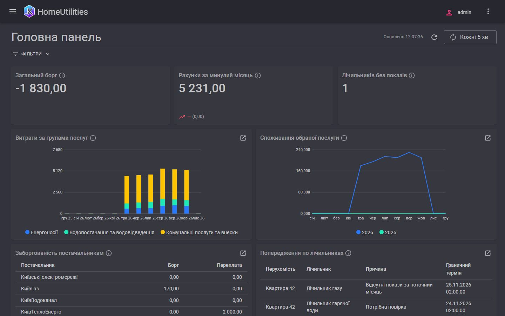

# Комунальні послуги й лічильники

[English](README.md) | **Українська**

Комунальні рахунки домогосподарства: показники лічильників, тарифи, що змінюються з часом, щомісячні рахунки від кожного
постачальника, оплати, хто кому скільки винен і як змінюється споживання з місяця в місяць.

## Що показує

- Тарифи й показники лічильників як **періодичні регістри відомостей**; споживання — різниця двох показників.
- Рядки рахунку **розраховуються** з показників, тарифів і площі житла, і їх можна змінити до проведення.
- Борг і передоплата за постачальником як **регістр залишків**; акт звірки з постачальником.
- Українські **платіжні реквізити** (IBAN, ЄДРПОУ) і призначення платежу за шаблоном постачальника — у рахунку, оплаті та їхніх друкованих формах.
- Зведена таблиця споживання рік до року, витрати за групами послуг, історія тарифів.
- Щоденні **нагадування** про відсутні показники та повірку лічильників і головний **дашборд** із фільтром.

## Бриф

[prompt/PROMPT.md](prompt/PROMPT.md) (v3), англійською.

## Як його побудовано

Першу версію за брифом побудував Google Antigravity (Gemini 3.8 Flash, medium). Далі в тій самій сесії було кілька
раундів покращень тією ж моделлю (українські платіжні реквізити й шаблони призначення платежу, друковані форми, оплата
за кількістю мешканців, демодані двома мовами), і агент записав їх назад у бриф. Потім застосунок перевірив і виправив
Gemini Argon 4 (high), а під час перенесення сюди — ще раз Claude Code (ще шість виправлень). Що зробив кожен крок — у [BUILD-NOTES.md](BUILD-NOTES.md) (англійською).

## Запуск

Застосунок — у [app/](app/); його [README](app/README.md) (англійською) пояснює, як зібрати, запустити з демоданими й
увійти.

