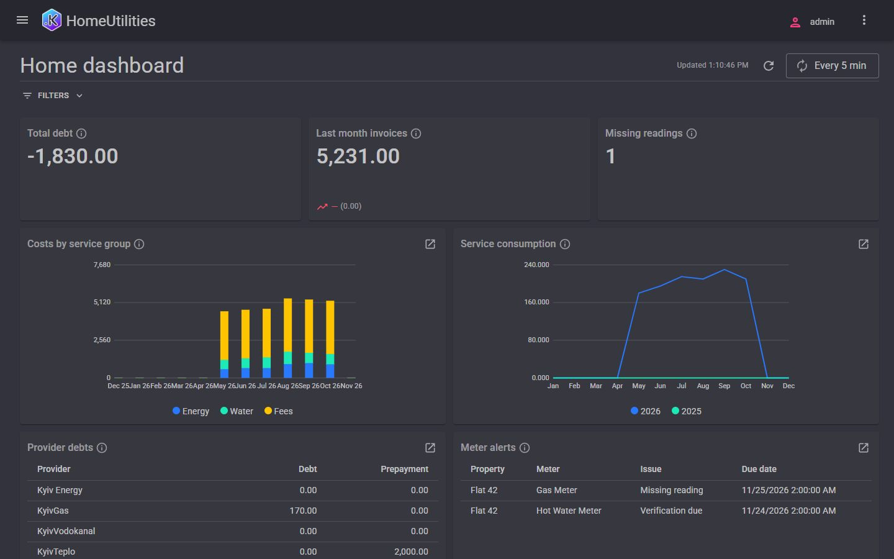
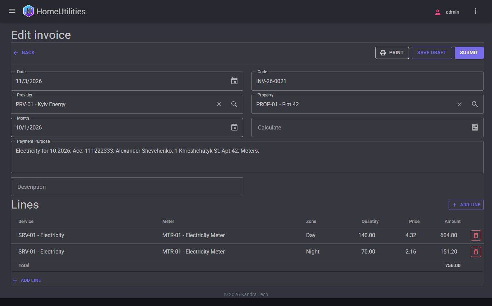
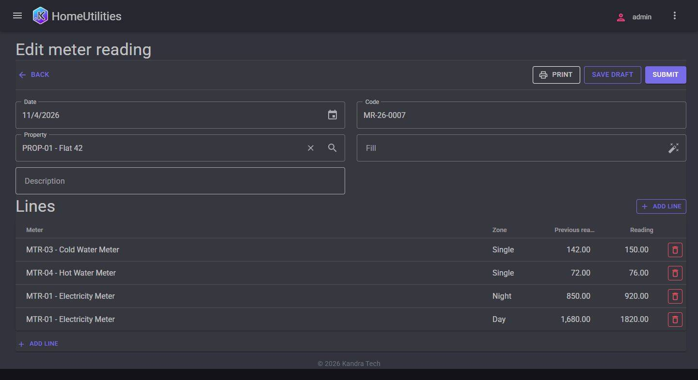
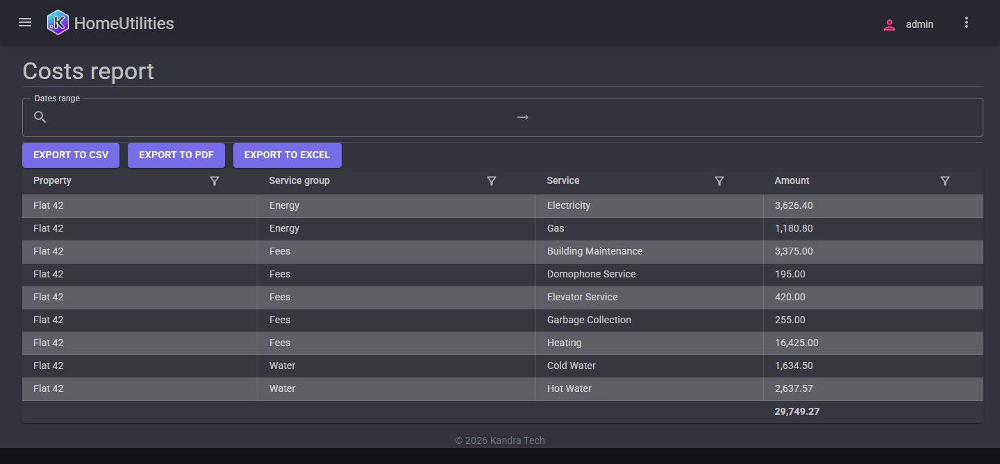
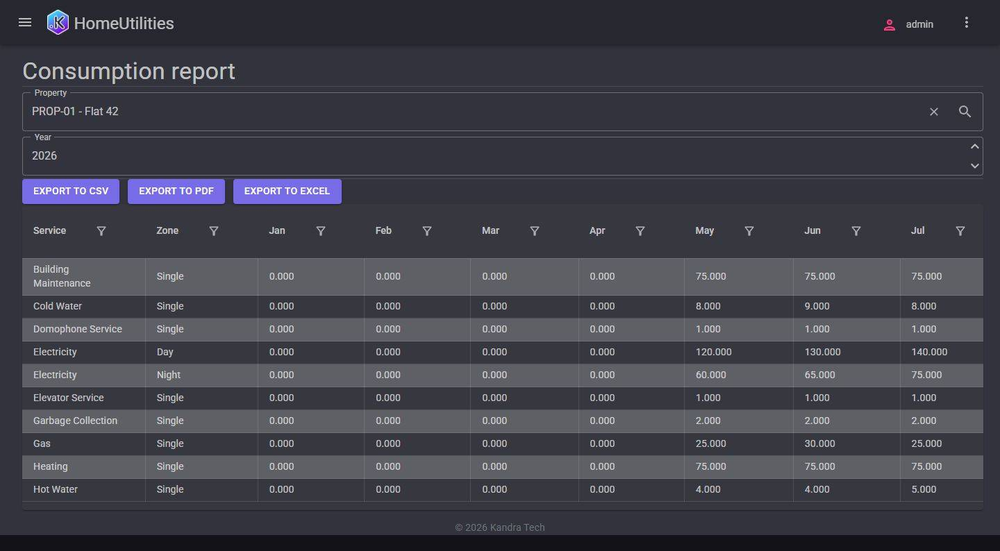

# HomeUtilities

A single-household utility billing and meter tracking application built on the Kandra ERP platform (.NET 10, SQLite).



## Features
- **Reference Data**: Properties, Providers, Hierarchical Services, Meters.
- **Documents**: Set Tariffs, Meter Reading (with automatic fill), Invoice (with consumption & tariff calculation, PDF print form), Payment.
- **Registers**: Periodic information registers (Tariffs, Meter Readings) and Accumulation registers (Settlements balances, Utility costs turnovers).
- **Home Dashboard**: Debt KPI, monthly invoice comparison, missing readings counter, 12-month stacked cost bar chart, 2-year consumption comparison line chart, provider debt table, meter alerts.
- **Reports**: Provider Statement, Consumption, Costs, Tariff History (with CSV/Excel/PDF export).
- **Reminders**: Scheduled notification check for missing readings and verification deadlines.
- **Localization**: Full English and Ukrainian language support.

## How to Build

```bash
dotnet restore
dotnet build
```

## How to Run Tests

```bash
dotnet test
```

## How to Run the Application (with Demo Data)

To launch the Web API and MudBlazor UI with the pre-seeded demo dataset:

### PowerShell
```powershell
$env:ACCEPT_EULA="Y"
$env:Kandra__Setup__Mode="Demo"
$env:Kandra__AdminPassword="Admin!1"
dotnet run --project src/HomeUtilities.WebApi --launch-profile HomeUtilities.UI
```

### Bash
```bash
ACCEPT_EULA="Y" Kandra__Setup__Mode="Demo" Kandra__AdminPassword="Admin!1" dotnet run --project src/HomeUtilities.WebApi --launch-profile HomeUtilities.UI
```

The demo data comes in two languages with the same content and different names: English (`homeutilities-demo-en`, the default) and Ukrainian (`homeutilities-demo-uk`). To load the Ukrainian one add `Kandra__Setup__DemoPackage=homeutilities-demo-uk` (environment variable `Kandra__Setup__DemoPackage`).

## Screenshots

| | |
|---|---|
|  |  |
|  |  |

Ukrainian versions of every screenshot are in [screenshots/](screenshots/) (`*.uk.jpg`).

## How to Sign In

- **URL**: [https://localhost:7227](https://localhost:7227) (or [http://localhost:5227](http://localhost:5227))
- **Username**: `admin`
- **Password**: `Admin!1`
