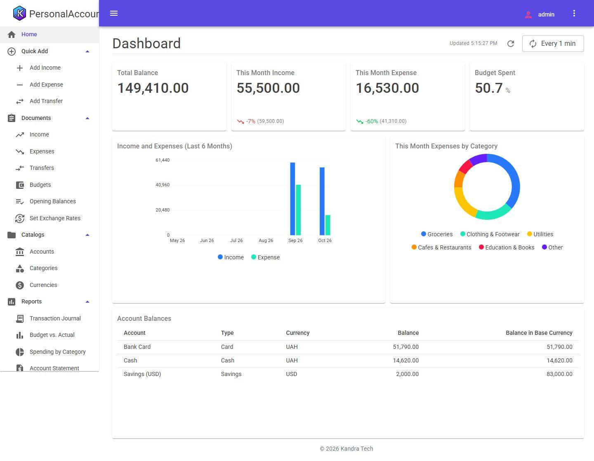

# Personal Accounting & Budgets

**English** | [Українська](README.uk.md)

A single-user application to record personal money movements across accounts in several currencies, see balances, and compare monthly spending with budgets.

## What it shows

- An **accumulation register with balances** (account balances) and one **of turnovers** (category turnover, in the account currency and in the base currency).
- **Periodic information registers** fed by documents: exchange rates (a "Set exchange rates" document, no rates catalog) and the budget plan bound to its Budget document.
- Opening balances as a document, not a field on the account.
- Reports over register movements: transaction journal, budget vs. actual, spending by category, account statement.
- A home **dashboard**: balance tiles, income vs. expense chart, expenses by category.

## Brief

[prompt/PROMPT.md](prompt/PROMPT.md) (v4)

## How it was built

The first version was built from the brief by Google Antigravity (Gemini 3.8 Flash, medium) in about 65 minutes, then
reviewed and polished with Claude Code (Claude Opus). The review fixed eight bugs and added tests (18 in the first
version, 21 now). What came from the brief, what the review changed and what is still weak:
[BUILD-NOTES.md](BUILD-NOTES.md).

## Run it

The application is in [app/](app/); its [README](app/README.md) says how to build, start with the demo data and sign in.

