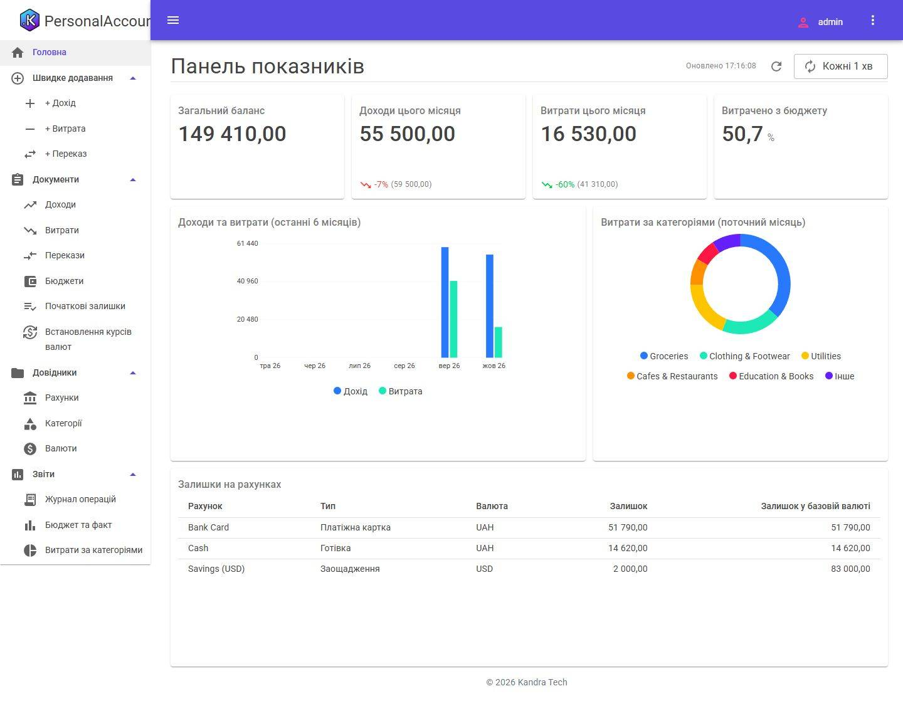

# Особистий облік і бюджети

[English](README.md) | **Українська**

Застосунок для однієї людини: облік особистих грошових операцій на рахунках у кількох валютах, залишки й порівняння
щомісячних витрат із бюджетами.

## Що показує

- **Регістр накопичення із залишками** (залишки на рахунках) і **регістр оборотів** (обороти за статтями, у валюті рахунку
  та в базовій валюті).
- **Періодичні регістри відомостей**, які заповнюють документи: курси валют (документ «Встановлення курсів», без довідника
  курсів) і план бюджету, прив'язаний до свого документа «Бюджет».
- Початкові залишки як документ, а не поле рахунку.
- Звіти за рухами регістрів: журнал операцій, бюджет проти факту, витрати за статтями, виписка за рахунком.
- Головний **дашборд**: плитки залишків, графік доходів і витрат, витрати за статтями.

## Бриф

[prompt/PROMPT.md](prompt/PROMPT.md) (v4), англійською.

## Як його побудовано

Першу версію за брифом побудував Google Antigravity (Gemini 3.8 Flash, medium) приблизно за 65 хвилин, потім її
перевірили й довели до ладу в Claude Code (Claude Opus). Рецензія виправила вісім помилок і додала тести (18 у першій
версії, 21 тепер). Що прийшло з брифу, що змінила рецензія і що ще слабке — у [BUILD-NOTES.md](BUILD-NOTES.md)
(англійською).

## Запуск

Застосунок — у [app/](app/); його [README](app/README.md) (англійською) пояснює, як зібрати, запустити з демоданими й
увійти.

