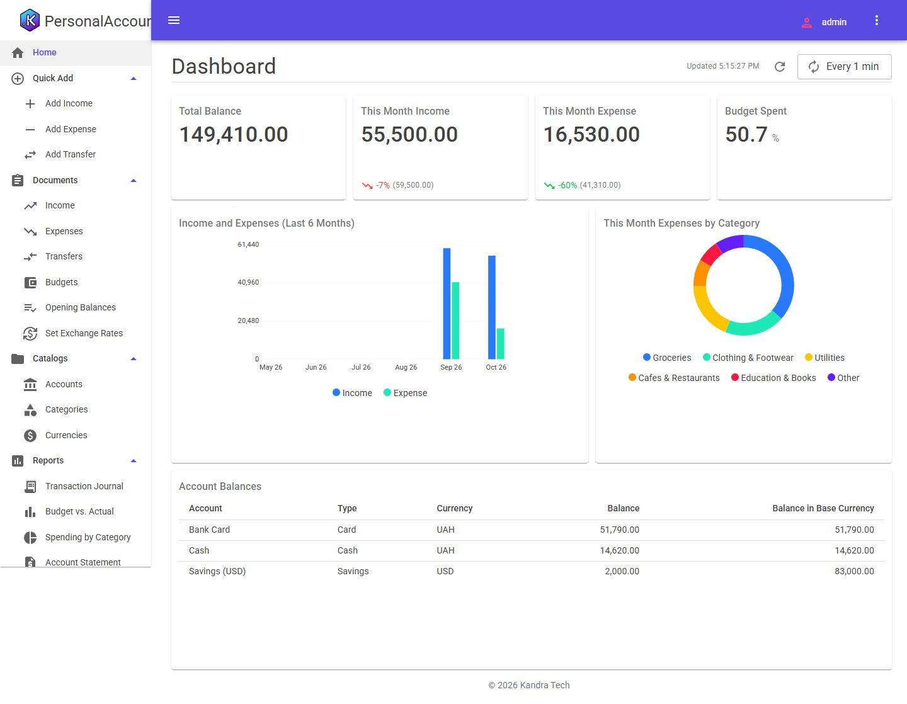
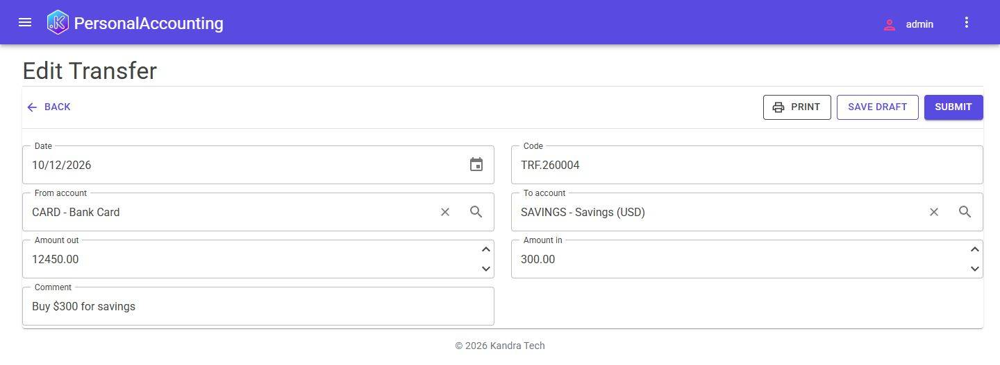
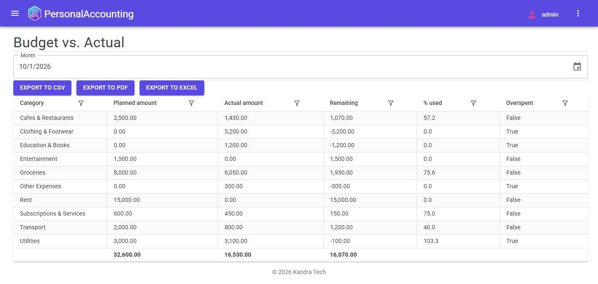
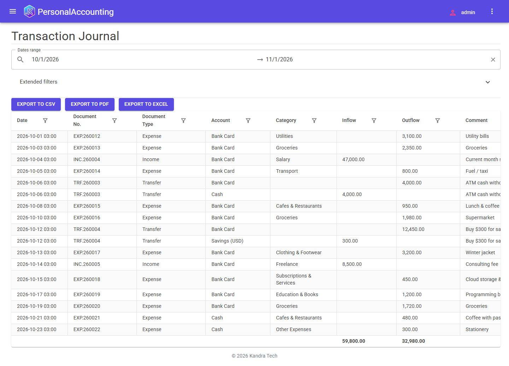
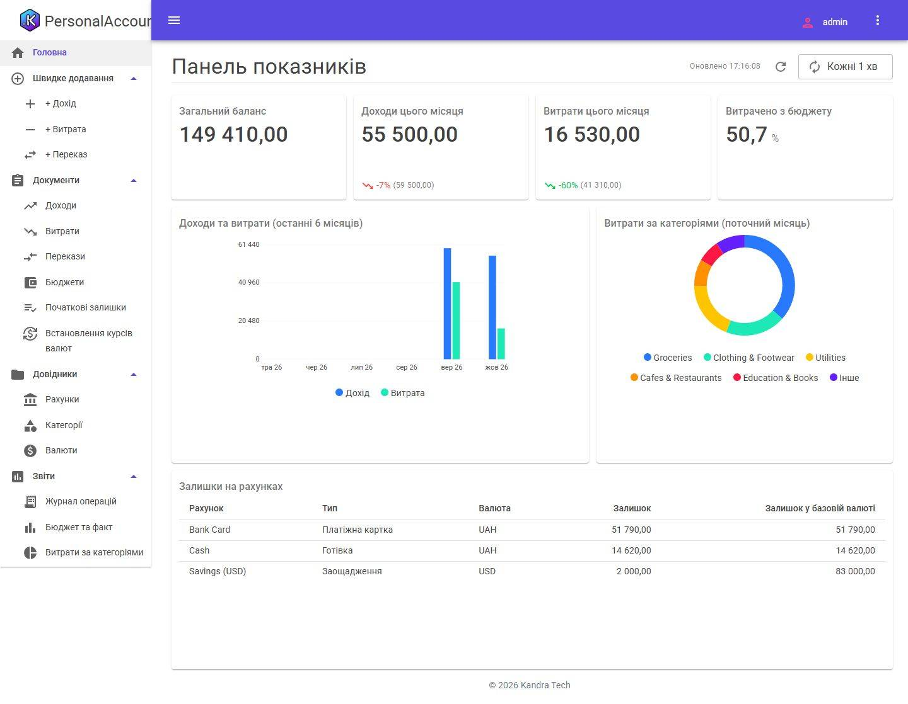

# Personal Accounting & Budgets

A single-user personal accounting application on the [Kandra](https://kandra.tech) engine, built by Google Antigravity
from [the brief](../../prompt/PROMPT.md). What the run is and how it was reviewed: [RESULTS.md](RESULTS.md).



## Build and test

Needs the .NET 10 SDK. Packages come from nuget.org and the public Kandra feed (`nuget.config`).

```bash
dotnet build PersonalAccounting.slnx
dotnet test PersonalAccounting.slnx
```

## Run with the demo data

```bash
dotnet run --project src/PersonalAccounting.WebApi --launch-profile PersonalAccounting.UI -- --ACCEPT_EULA=Y --Kandra:Setup:Mode=Demo
```

Open `https://localhost:7225` (accept the development certificate) and sign in as `admin` / `Admin!1`. The demo
installation loads accounts in UAH and USD, a category tree, exchange rates, opening balances, this month's budget and
about thirty posted incomes, expenses and transfers dated relative to today.

Without `--Kandra:Setup:Mode=Demo` the first start opens the setup wizard, which creates the administrator and an empty
database. The SQLite file is in `src/PersonalAccounting.WebApi/db/`; delete it to start again.

## Screenshots

| | |
|---|---|
|  |  |
|  |  |

Ukrainian versions of every screenshot are in [screenshots/](screenshots/) (`*.uk.jpg`).
